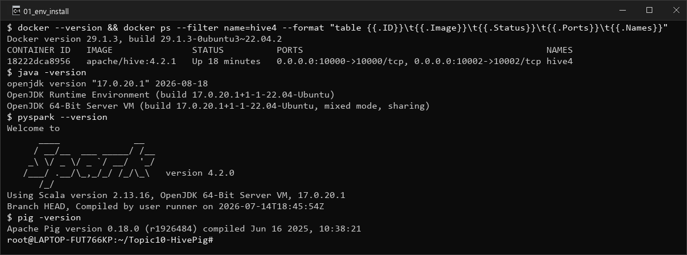
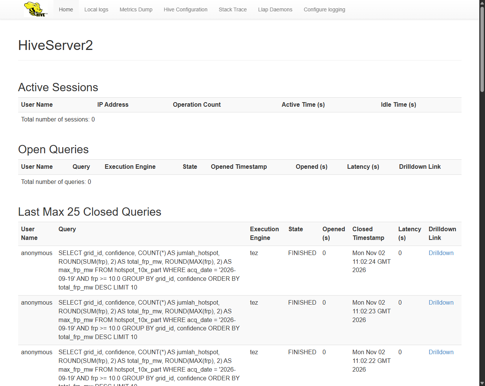
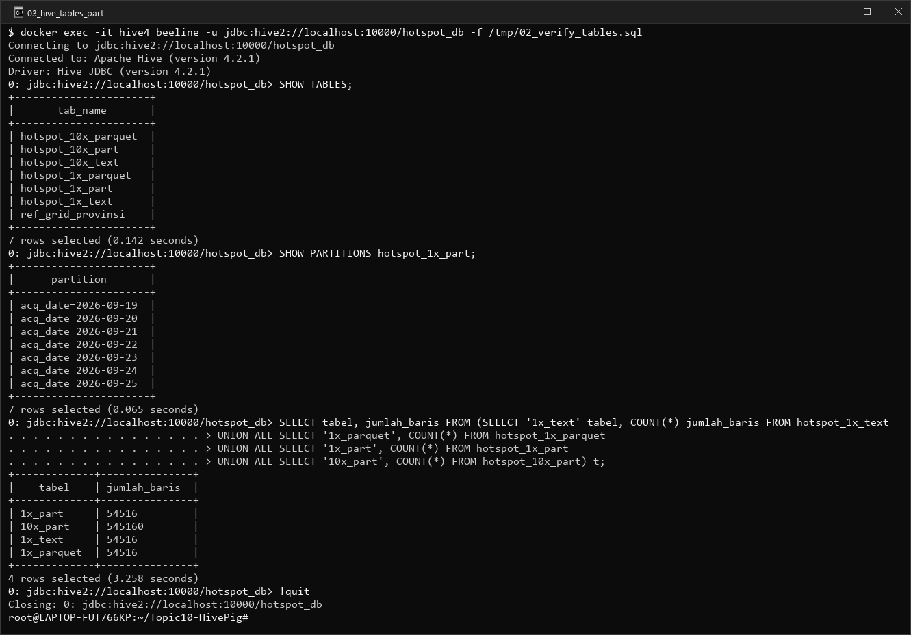
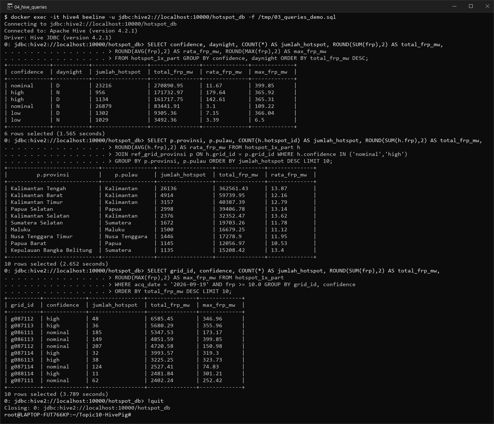
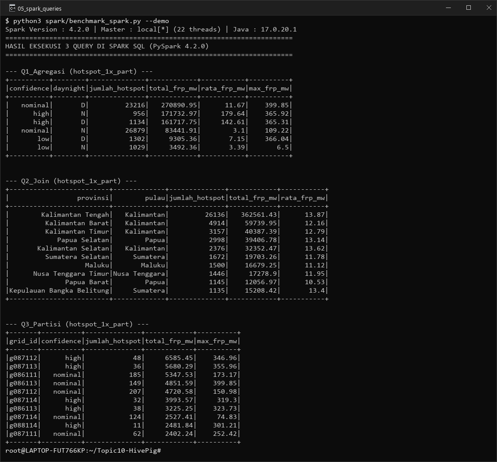
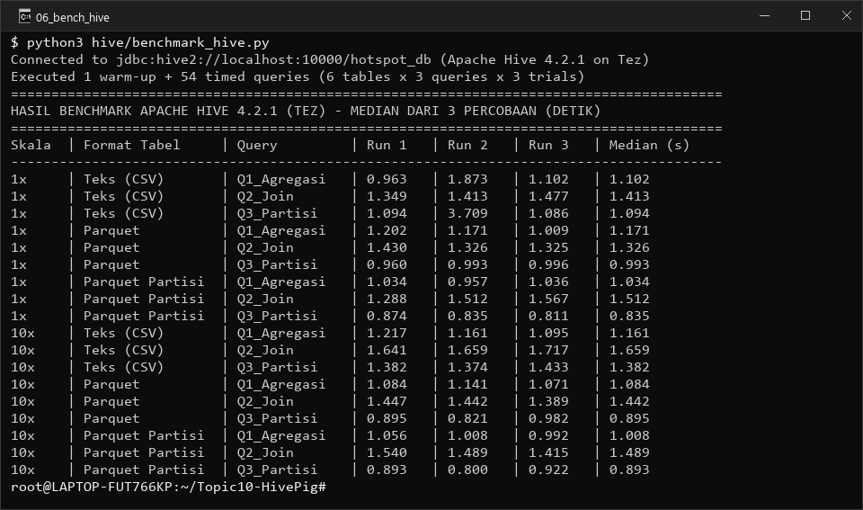
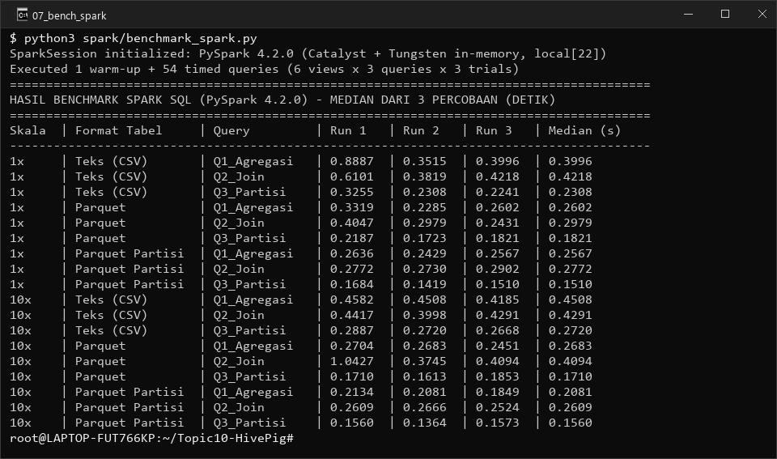
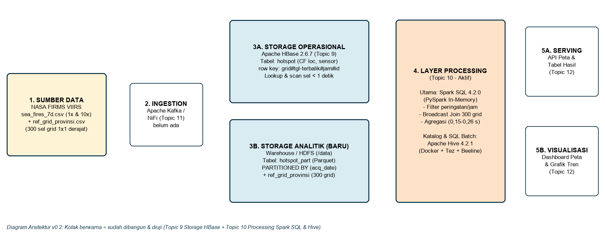

# Desain Lapisan Processing (Hive dan Spark SQL): Pemantauan Titik Api Indonesia

Teknologi Big Data - Topic 10 - Tugas Kelompok

| Kelompok 6 | NPM | Pembagian tugas |
|---|---|---|
| Muhammad Bryan Farras | 2306230975 | Bab 1 (konteks kasus, peran layer processing, 3 query) dan Bab 4 (analisis waktu, format, partisi, proyeksi 100x) |
| Mirza Adi Raffiansyah | 2306210323 | Bab 2 (desain skema tabel Teks, Parquet, Partisi tanggal, dan tabel referensi provinsi) |
| Calvin Wirathama Katoroy | 2306242395 | Bab 3 (instalasi Docker, Hive 4.2.1, PySpark 4.2.0, hands-on, screenshot, uji waktu median 3x) |
| Salim | 2306204604 | Bab 5 (satu halaman Catatan Keputusan Desain), Diagram Arsitektur v0.2, dan penyusunan PDF |

---

## Bab 1. Konteks Kasus Kelompok dan Peran Lapisan Processing

**Keterkaitan dengan kasus kelompok.** Laporan ini melanjutkan arsitektur sistem **pemantauan titik api (*hotspot*) kebakaran hutan dan lahan di Indonesia** menggunakan data satelit **VIIRS NASA FIRMS** (`sea_fires_7d.csv`, periode 19–25 September 2026) yang telah dirancang lapisan *storage*-nya pada **Topic 9 (Apache HBase)**. Pada Topic 9, sampel wilayah Indonesia mencakup **54.516 baris** (rata-rata 7.788 titik/hari, puncak 10.974 titik pada 19 Sep dan 5.686 titik pada 25 Sep) yang tersebar pada **300 sel grid** berukuran $1^\circ \times 1^\circ$.

**Pembagian peran Storage (Topic 9) lawan Processing (Topic 10).** Pada Topic 9, tabel HBase `hotspot` (row key `grid#tanggal_terbalik#jam#urut`) terbukti sangat cepat untuk *lookup* satu titik (`get` 0,073 detik) dan *range scan* satu sel grid (`scan` 925 baris pada `g087112` dalam 0,967 detik). Namun, HBase tidak memiliki fitur `JOIN` maupun agregasi `GROUP BY` bawaan, serta harus memindai seluruh tabel bila menyaring kolom non-key (`ValueFilter` memindai 100% baris). Oleh karena itu, sesuai peta pertanyaan data pada Bab 1 Topic 9, **Pertanyaan 4** (*penyaringan lintas sel tiap jam untuk peringatan dini*) dan **Pertanyaan 5** (*agregasi harian dan penggabungan ke batas provinsi*) diserahkan ke **lapisan processing** menggunakan **Apache Hive** dan **Apache Spark SQL**.

| No | Pertanyaan Data Kasus Titik Api | Pola Akses | Frekuensi | Lapisan & Mesin Penjawab |
|---|---|---|---|---|
| 1 | 20 titik api terbaru pada satu sel grid $X$ (peta wilayah) | Scan rentang sempit | Setiap peta dibuka | Storage Operasional: **HBase** (Topic 9) |
| 2 | Detail satu titik api saat diklik pada peta | Lookup per key (`get`) | Puluhan kali/menit | Storage Operasional: **HBase** (Topic 9) |
| 3 | Titik api pada sel $X$ dalam $N$ hari terakhir | Scan rentang sempit | Beberapa kali/menit | Storage Operasional: **HBase** (Topic 9) |
| 4 | Peringatan dini titik api berbahaya (`FRP >= 10 MW` / `high`) pada hari puncak | Filter partisi & agregasi | Tiap jam | Processing: **Spark SQL / Hive** (**Query 3 Topic 10**) |
| 5 | Ringkasan jumlah titik api dan intensitas FRP per kategori serta per provinsi | Agregasi & Join referensi | Tiap jam / harian | Processing: **Spark SQL / Hive** (**Query 1 & 2 Topic 10**) |

---

## Bab 2. Desain Skema Tabel (Teks, Parquet, Berpartisi) dan Tiga Query Uji

**Ukuran data uji (1x dan 10x).** Agar pengujian mencerminkan beban nyata sekaligus mengukur dampak skala data di luar waktu *start-up*, pengujian dilakukan pada dua skala data di direktori `/data` (`/root/topic10-data` pada filesystem `ext4` WSL2):
1. **Data Kecil (`1x` — `hotspot_1x`)**: **54.516 baris** (±4,71 MB CSV), berisi seluruh deteksi titik api wilayah Indonesia selama 7 hari (19–25 September 2026) dengan distribusi identik Topic 9 (`nominal` 50.095, `low` 2.331, `high` 2.090; sel terpadat `g087112` = 5.107 baris).
2. **Data Diperbesar (`10x` — `hotspot_10x`)**: **545.160 baris** (±47,71 MB CSV), yaitu perbesaran $10\times$ lipat dari data `1x` (ID unik `1..954516` dan variasi terukur pada nilai FRP) yang merepresentasikan akumulasi ±70 hari pengamatan musim kemarau.
3. **Tabel Referensi Wilayah (`ref_grid_provinsi`)**: **300 baris** yang memetakan setiap kode sel grid $1^\circ \times 1^\circ$ (`grid_id`, mis. `g087112`) ke nama `provinsi`, `pulau`, `tingkat_rawan`, dan `luas_gambut_ha` untuk kebutuhan operasi `JOIN`.

**Tiga varian format tabel pada Hive dan Spark SQL.** Pada masing-masing skala (`1x` dan `10x`), dataset dimuat ke dalam tiga varian tabel di database `hotspot_db`:

| Varian Tabel | Nama Tabel (`1x` / `10x`) | Jenis & Format Penyimpanan | Karakteristik Pembacaan Data |
|---|---|---|---|
| **1. Teks (CSV)** | `hotspot_1x_text` / `hotspot_10x_text` | `EXTERNAL TABLE`, `ROW FORMAT DELIMITED FIELDS TERMINATED BY ',' STORED AS TEXTFILE` | Membaca seluruh baris dan seluruh 14 kolom dari disk serta melakukan *parsing* teks ke tipe numerik saat query berjalan. |
| **2. Parquet** | `hotspot_1x_parquet` / `hotspot_10x_parquet` | `MANAGED TABLE`, `STORED AS PARQUET` (non-partisi) | Format kolumnar biner terkompresi dengan skema dan statistik `min/max` tertanam; hanya membaca kolom yang diminta query (*column projection*). |
| **3. Parquet Berpartisi** | `hotspot_1x_part` / `hotspot_10x_part` | `PARTITIONED BY (acq_date STRING) STORED AS PARQUET` (7 partisi tanggal: `2026-09-19` s/d `2026-09-25`) | Menggabungkan proyeksi kolom Parquet dengan **Partition Pruning**: query dengan `WHERE acq_date = '...'` hanya membaca folder tanggal tersebut. |

**Alasan pemilihan kolom partisi `acq_date`.** Kolom `acq_date` dipilih karena berjumlah terukur (7 nilai unik untuk 7 hari, atau ±365 folder/tahun) dan selalu menjadi filter utama pada laporan harian maupun peringatan dini. Kami menghindari partisi pada kolom berkardinalitas sangat tinggi seperti `hotspot_id` (54.516 nilai unik) karena akan memecah data menjadi puluhan ribu file kecil (*small files problem*) yang membebani Metastore dan NameNode HDFS.

**Tiga query pengujian (Agregasi, Join, dan Partisi).** Ketiga query dirancang menggunakan sintaks SQL standar yang berjalan identik di **Apache Hive** maupun **Apache Spark SQL**:
1. **`Q1_Agregasi` (Agregasi Multi-Dimensi)**: Menghitung jumlah titik api (`COUNT`), total daya radiasi api (`SUM(frp)`), rata-rata (`AVG(frp)`), dan nilai maksimum (`MAX(frp)`) yang dikelompokkan berdasarkan tingkat keyakinan (`confidence`) dan waktu pengamatan siang/malam (`daynight`).
2. **`Q2_Join` (Join Tabel Fakta dengan Dimensi Provinsi)**: Menggabungkan (`INNER JOIN`) tabel titik api dengan tabel referensi `ref_grid_provinsi` melalui kunci `grid_id` untuk titik api berkeyakinan `nominal` dan `high`, lalu mengurutkan **10 provinsi dengan jumlah titik api tertinggi**.
3. **`Q3_Partisi` (Filter Kolom Partisi + Ambang Peringatan Dini)**: Menyaring titik api khusus pada hari puncak kemarau `WHERE acq_date = '2026-09-19' AND frp >= 10.0`, lalu menghitung jumlah titik api, total FRP, dan puncak FRP per sel `grid_id` dan `confidence` (10 sel paling berbahaya).

---

## Bab 3. Bukti Hands-on Instalasi, Eksekusi Query, dan Pengukuran Waktu

**Spesifikasi lingkungan kerja.** Pengujian dijalankan pada satu mesin fisik yang sama agar perbandingan adil: **Windows 11 + WSL2 (`Ubuntu-22.04`, kernel `5.15.167.4-microsoft-standard-WSL2`)**, prosesor **Intel Core Ultra 7 155H (22 vCPU)**, **RAM 7,5 GiB** (dialokasikan ke WSL2), dan penyimpanan SSD NVMe (`ext4`).
- **Lingkungan Apache Hive**: **Docker Engine `29.1.3`** menjalankan kontainer resmi **`apache/hive:4.2.1`** (`hive4`, membawa OpenJDK 21, HiveServer2, Embedded Derby Metastore, dan mesin eksekusi **Apache Tez**). Klien yang digunakan adalah **Beeline JDBC** (`jdbc:hive2://localhost:10000/hotspot_db`).
- **Lingkungan Apache Spark SQL**: **PySpark `4.2.0`** (`pip install pyspark==4.2.0 pyarrow pandas`) berjalan di atas **OpenJDK `17.0.20.1`** dan **Python `3.10.12`** dengan mode `local[*]` (22 *thread* paralel di memori, `spark.sql.shuffle.partitions = 8`). Sebagai pelengkap opsional materi kuliah, **Apache Pig `0.18.0`** juga telah dipasang dan diverifikasi di `/root/pig-0.18.0`.

**Gambar 1.** Verifikasi instalasi `docker --version` (29.1.3), kontainer `hive4` (`apache/hive:4.2.1` aktif di port 10000 & 10002), `java -version` (OpenJDK 17.0.20.1), `pyspark --version` (Spark 4.2.0), dan `pig -version` (0.18.0). Menjawab: seluruh *tools* lapisan *processing* terpasang dan berjalan.

**Gambar 2.** Antarmuka web **HiveServer2** pada `http://localhost:10002` yang menampilkan versi Apache Hive `4.2.1`, sesi aktif, serta daftar query SQL yang dieksekusi melalui engine **Tez**. Menjawab: layanan server Hive dan Metastore aktif melayani klien JDBC.

**Gambar 3.** Eksekusi `SHOW TABLES`, `SHOW PARTITIONS hotspot_1x_part`, dan verifikasi jumlah baris di Beeline Hive (`54.516` baris pada tabel `1x` dan `545.160` baris pada tabel `10x`, terbagi ke dalam 7 partisi tanggal `2026-09-19` s/d `2026-09-25`). Menjawab: dataset kasus kelompok berhasil dimuat ke tabel Teks, Parquet, dan Berpartisi.

**Gambar 4.** Hasil eksekusi ketiga query (`Q1_Agregasi`, `Q2_Join`, dan `Q3_Partisi`) pada tabel `hotspot_1x_part` di **Apache Hive 4.2.1**. Terlihat Kalimantan Tengah memimpin dengan 26.136 titik api (`362.561,43 MW`), dan sel `g087112` menjadi sel terpanas pada hari puncak 19 September (`6.585,45 MW` dari 48 titik *high confidence*). Menjawab: ketiga query berjalan menghasilkan jawaban analitik kasus kelompok di Hive.

**Gambar 5.** Hasil eksekusi ketiga query yang sama persis di **Apache Spark SQL (`PySpark 4.2.0`)**. Seluruh angka jumlah baris, total FRP, rata-rata FRP, dan urutan 10 provinsi/grid teratas **100% identik** dengan keluaran Hive pada Gambar 4. Menjawab: konsistensi hasil query lintas mesin (Hive lawan Spark SQL).

**Gambar 6.** Hasil pengukuran waktu eksekusi **3 kali percobaan beserta nilai median** pada **Apache Hive 4.2.1 (Tez)** untuk seluruh kombinasi skala data (`1x` dan `10x`) dan format tabel (Teks, Parquet, Parquet Partisi).

**Gambar 7.** Hasil pengukuran waktu eksekusi **3 kali percobaan beserta nilai median** pada **Apache Spark SQL (`PySpark 4.2.0`)** untuk seluruh kombinasi skala data (`1x` dan `10x`) dan format tabel.

---

## Bab 4. Perbandingan Waktu Eksekusi Hive vs Spark SQL dan Analisis Teknis

**Tabel perbandingan waktu median (dari 3 kali percobaan).** Setelah 1 kali *warm-up* sesi, setiap kombinasi dijalankan 3 kali berturut-turut dan diambil nilai **median**-nya (dalam satuan detik):

| Query | Format Tabel | Hive `1x` (54,5 rb) | Spark `1x` (54,5 rb) | Hive `10x` (545,1 rb) | Spark `10x` (545,1 rb) | Percepatan Spark (`10x`) |
|---|---|---:|---:|---:|---:|---:|
| **`Q1_Agregasi`** | Teks (CSV) | 1,102 s | 0,400 s | 1,161 s | 0,451 s | **2,57× lebih cepat** |
| **`Q1_Agregasi`** | Parquet | 1,171 s | 0,260 s | 1,084 s | 0,268 s | **4,04× lebih cepat** |
| **`Q1_Agregasi`** | Parquet Partisi | 1,034 s | 0,257 s | 1,008 s | 0,208 s | **4,85× lebih cepat** |
| **`Q2_Join`** | Teks (CSV) | 1,413 s | 0,422 s | 1,659 s | 0,429 s | **3,87× lebih cepat** |
| **`Q2_Join`** | Parquet | 1,326 s | 0,298 s | 1,442 s | 0,409 s | **3,53× lebih cepat** |
| **`Q2_Join`** | Parquet Partisi | 1,512 s | 0,277 s | 1,489 s | 0,261 s | **5,70× lebih cepat** |
| **`Q3_Partisi`** | Teks (CSV) | 1,094 s | 0,231 s | 1,382 s | 0,272 s | **5,08× lebih cepat** |
| **`Q3_Partisi`** | Parquet | 0,993 s | 0,182 s | 0,895 s | 0,171 s | **5,23× lebih cepat** |
| **`Q3_Partisi`** | Parquet Partisi | **0,835 s** | **0,151 s** | **0,893 s** | **0,156 s** | **5,72× lebih cepat** |

### Analisis Teknis Hasil Pengukuran

1. **Mengapa format file (Teks CSV lawan Parquet) sangat berpengaruh?**
   Pada format **Teks (CSV)**, baik Hive maupun Spark harus membaca seluruh 14 kolom pada setiap baris (4,71 MB pada `1x` dan 47,71 MB pada `10x`) lalu memecah delimiter koma dan mengubah string menjadi `DOUBLE`/`INT` di CPU. Sebaliknya, **Parquet** menyimpan data secara **kolumnar biner** dan terkompresi (ukuran fisik di disk menyusut menjadi ±8,9 MB untuk 545.160 baris, hemat >80% I/O). Karena `Q1_Agregasi` hanya membutuhkan 3 kolom (`confidence`, `daynight`, `frp`), pembaca Parquet langsung melompati 11 kolom lainnya (*column projection*) dan memanfaatkan *vectorized reader* serta statistik `min/max` per *row group*. Di Spark SQL (`10x`), peralihan dari CSV ke Parquet mempercepat `Q1_Agregasi` dari `0,451 detik` menjadi `0,268 detik` (**1,68× lebih cepat**) dan di Hive mempercepat `Q3_Partisi` dari `1,382 detik` menjadi `0,895 detik` (**1,54× lebih cepat**).
2. **Mengapa partisi (`PARTITIONED BY acq_date`) mempercepat query filter tanggal?**
   Pada `Q3_Partisi` (`WHERE acq_date = '2026-09-19' AND frp >= 10.0`), tabel non-partisi tetap harus memeriksa berkas data seluruh 7 hari (545.160 baris pada `10x`). Dengan **Parquet Berpartisi**, Hive dan Spark melakukan **Partition Pruning** sejak tahap perencanaan logika: mesin hanya membuka sub-direktori `acq_date=2026-09-19` (109.740 baris pada `10x`, yaitu hanya **20,1% dari total baris**) dan mengabaikan 6 direktori tanggal lainnya. Hasilnya, waktu `Q3_Partisi` mencapai rekor tercepat di kedua mesin: **0,835 detik** (`1x`) dan **0,893 detik** (`10x`) di Hive, serta **0,151 detik** (`1x`) dan **0,156 detik** (`10x`) di Spark SQL. Sebaliknya, pada `Q1_Agregasi` dan `Q2_Join` yang tidak memiliki klausa `WHERE acq_date`, partisi tidak memangkas data karena seluruh 7 folder partisi harus tetap dibaca.
3. **Mengapa Spark SQL 2,5×–5,7× lebih cepat daripada Hive (Tez), dan apa perbedaan sintaksnya?**
   - **Arsitektur Eksekusi**: Meskipun Hive 4.2.1 sudah menggunakan **Apache Tez** (DAG tanpa tulis ulang ke HDFS di tiap langkah MapReduce), setiap query tetap melewati kompilasi rencana HiveServer2, serialisasi *task* Tez, dan manajemen kontainer. Sebaliknya, **Spark SQL** menggunakan **Catalyst Optimizer** dan **Tungsten Whole-Stage Code Generation** yang menyusun bytecode Java langsung dan memproses data di memori (*in-memory*) menggunakan 22 *thread* executor yang sudah menyala, termasuk melakukan **Broadcast Hash Join** otomatis untuk tabel kecil `ref_grid_provinsi` (300 baris) pada `Q2_Join`.
   - **Perbedaan Sintaks & Penanganan Skema**: Sintaks query `SELECT ... JOIN ... GROUP BY` **100% sama** di kedua mesin. Perbedaannya terletak pada tahap definisi tabel: Hive mendeklarasikan skema di Metastore (`CREATE EXTERNAL TABLE ... PARTITIONED BY ...` dan `SET hive.exec.dynamic.partition.mode=nonstrict`), sedangkan PySpark mendaftarkan skema secara terprogram lewat `StructType` / `spark.read.parquet(...).createOrReplaceTempView(...)` atau menulis partisi dengan `df.write.partitionBy("acq_date").parquet(...)`.
4. **Analisis Skalabilitas: Bagaimana jika data diperbesar dari `1x` ke `10x`, dan proyeksi pada `100x`?**
   - **Dari `1x` (54,5 ribu baris) ke `10x` (545,1 ribu baris)**: Waktu eksekusi hanya naik tipis (misal `Q3_Partisi` CSV di Hive naik dari `1,094 s` ke `1,382 s`, dan Parquet Partisi hampir konstan di `0,835 s` vs `0,893 s`). Hal ini membuktikan bahwa pada skala puluhan hingga ratusan ribu baris, waktu yang terukur masih didominasi oleh **biaya tetap (*start-up & scheduling overhead*)** sebesar ±0,8 detik di Hive dan ±0,15 detik di Spark.
   - **Proyeksi pada `100x` (5,45 juta baris, ±477 MB CSV) dan Arsip 10 Tahun (`85 juta baris`, ±7 GB CSV)**: Pada skala `100x` ke atas, waktu pemindaian I/O dan komputasi *shuffle* akan mendominasi waktu *start-up*. Tabel **Teks (CSV)** akan melambat secara linear ($10\times$–$100\times$ lebih lama), sedangkan **Parquet Berpartisi `acq_date`** akan menjaga waktu query harian (`Q3_Partisi`) tetap rendah karena hanya membaca 1 folder tanggal. Dari sisi mesin: **Spark SQL** akan tetap unggul selama memori RAM mencukupi untuk menahan data *shuffle* di memori; namun jika ukuran data melebihi kapasitas RAM klaster (misal join besar ratusan GB pada mesin bermemori sempit), Spark dapat mengalami *spill to disk* atau `OutOfMemoryError` (OOM), sedangkan **Hive + Tez** dirancang lebih tahan banting untuk memproses *batch* raksasa secara bertahap dengan konsumsi memori yang lebih hemat.

\newpage

## Bab 5. Catatan Keputusan Desain dan Diagram Arsitektur v0.2

Halaman ini memuat **Catatan Keputusan Desain** untuk lapisan *processing* pada proyek pemantauan titik api Indonesia beserta **Diagram Arsitektur v0.2** yang memadukan lapisan *storage* (Topic 9) dan lapisan *processing* (Topic 10).

| Bagian | Isi Keputusan Desain untuk Proyek Pemantauan Titik Api Indonesia (Kelompok 6) |
|---|---|
| **Keputusan** | Memilih **Apache Spark SQL (`PySpark 4.2.0`) di atas penyimpanan kolumnar Apache Parquet yang dipartisi berdasarkan tanggal (`acq_date`)** sebagai mesin *processing* utama proyek, sambil mempertahankan **Hive Metastore / Tabel Eksternal Parquet** agar dataset tetap dapat diakses dengan SQL deklaratif oleh analis maupun alat BI via JDBC. |
| **Konteks** | Sistem memantau titik api VIIRS Indonesia (**54.516 baris/7 hari**, rata-rata **7.788 titik/hari**, puncak **10.974 titik/hari**, proyeksi arsip 10 tahun **±85 juta baris** di **300 sel grid**). Lapisan *storage* operasional **HBase** (Topic 9) sudah menangani *lookup* per titik (`0,073 detik`) dan *range scan* per sel (`0,967 detik`), tetapi sistem membutuhkan lapisan *processing* untuk menjawab dua beban kerja analitik: **(1) Peringatan dini tiap jam (Pertanyaan 4)** untuk menyaring titik api berbahaya (`FRP >= 10–50 MW` / confidence `high`) pada hari berjalan, dan **(2) Laporan agregasi harian per provinsi (Pertanyaan 5)** yang menggabungkan (`JOIN`) titik api dengan 300 sel grid batas provinsi (`ref_grid_provinsi`). Selain itu, di masa depan pipeline ini akan diperluas ke *streaming* (Topic 11: Kafka) dan klasifikasi risiko berbasis *machine learning*. |
| **Alternatif yang Ditolak** | 1. **Format Teks (CSV) tanpa partisi**: Ditolak karena selalu membaca seluruh 14 kolom dan memindai seluruh riwayat tanggal; pada uji `10x`, `Q3_Partisi` di CSV membutuhkan `1,382 detik` (Hive) dan `0,272 detik` (Spark), lebih lambat hingga **54%–74%** dibanding Parquet Berpartisi (`0,893 detik` di Hive dan `0,156 detik` di Spark) serta memakan ruang disk 5× lebih besar. 2. **Apache Hive (Tez) sebagai satu-satunya mesin processing**: Ditolak untuk pekerjaan peringatan dini per jam dan pipeline terpadu karena latensi *overhead* Tez (`0,835–1,659 detik`) **2,6× hingga 5,7× lebih lambat** dibandingkan Spark SQL (`0,151–0,451 detik`), serta Hive tidak mendukung *stream processing* maupun *machine learning* (MLlib) dalam satu mesin. 3. **Apache Pig (`Pig Latin`)**: Ditolak karena mengharuskan penulisan skrip *dataflow* prosedural yang terpisah dari standar SQL yang sudah dikuasai seluruh anggota tim, tidak interaktif, dan dukungan ekosistemnya jauh lebih kecil dibanding Spark SQL. |
| **Konsekuensi & Trade-off** | 1. **Konsumsi Memori Lebih Tinggi**: Spark SQL menyimpan data perantara dan *hash table* (`BroadcastHashJoin`) di RAM, sehingga alokasi memori executor dan parameter `spark.sql.shuffle.partitions` harus dijaga agar tidak terjadi *Out-Of-Memory (OOM)* saat memproses arsip multi-tahun. 2. **Tahap Konversi ETL ke Parquet Berpartisi**: Data CSV mentah yang masuk dari NASA FIRMS / HBase harus dikonversi terlebih dahulu menjadi Parquet berpartisi `acq_date` (dan dijaga agar tidak menghasilkan banyak *small files* melalui `coalesce`/`repartition` per tanggal). 3. **Arsitektur Hibrida (Storage + Processing)**: Tim mengelola dua jalur yang saling melengkapi—**HBase** untuk pembacaan peta berlatensi milidetik per *row key*, dan **Spark SQL + Parquet Berpartisi** untuk agregasi, join spasial provinsi, serta analitik berkecepatan tinggi. |
| **Bukti Pengukuran Sendiri** | Pengukuran median 3 kali percobaan pada mesin kami (22 vCPU, RAM 7,5 GiB) membuktikan: • **Keunggulan Mesin (Spark SQL vs Hive pada data `10x` Parquet Partisi)**: `Q1_Agregasi` **0,208 s** vs **1,008 s** (**4,85× lebih cepat**); `Q2_Join` **0,261 s** vs **1,489 s** (**5,70× lebih cepat**); `Q3_Partisi` **0,156 s** vs **0,893 s** (**5,72× lebih cepat**). • **Keunggulan Format & Partisi (`Q3_Partisi` pada data `10x`)**: Beralih dari Teks CSV ke Parquet Berpartisi memangkas waktu di Hive dari **1,382 s → 0,893 s** (hemat **35,4%**) dan di Spark SQL dari **0,272 s → 0,156 s** (hemat **42,6%**) karena *Partition Pruning* hanya membaca 1 dari 7 partisi (`109.740` dari `545.160` baris). |

**Diagram Arsitektur v0.2** *(garis penuh = komponen Storage & Processing yang sudah dibangun dan diuji pada Topic 9–10; kotak putus-putus = lapisan Ingestion & Serving/Visualisasi untuk Topic 11–12)*:

